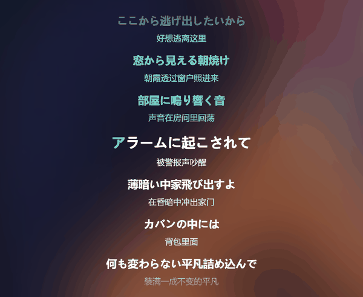

# 译光 · LyricLume

[中文](README.md) · [English](README.en.md)



**给 Spotify 加上 QQ 音乐级别的逐字歌词和中文翻译。**

Spotify 自带的歌词对日语歌常常没有翻译，而 QQ 音乐的翻译质量高、还带逐字时间轴。LyricLume 把两边接起来：从 Spotify 读当前播放的歌曲，去 QQ 音乐抓对应歌词和翻译，再用一套逐字染色引擎画在全屏界面上——原文在上、译文在下，唱到哪个字，哪个字变色。

> Spotify has no translations for most Japanese songs. LyricLume fetches the lyrics **and** Chinese translations from QQ Music, then renders them with word-level karaoke highlighting inside Spotify.

---

## 特性

- **逐字染色**：按 QQ 音乐的逐字时间轴，从左到右连续扫过，不是整句突变
- **翻译同步**：译文按原文词时长切分，原文唱到哪，译文跟到哪
- **一屏一句不挤**：当前句放大，其余保持白色，深色/浅色背景下都看得清
- **翻译开关**：右下角「译」按钮，一键显示/隐藏
- **悬停跳转**：鼠标移到某句，右侧浮出 `▶ 0'47''`，点播放键从那里开始
- **滚轮 / 拖拽**：歌词可以手动上下滑，松手 4 秒后自动回到当前句
- **封面展开**：点封面放大，歌词右移缩小，歌名渐隐
- **9 组配色**：3×3 色板，随便挑
- **本地缓存**：同一首歌只请求一次，切歌秒出
- **零账号**：不需要登录 QQ 音乐，不需要任何 API Key

---

## 安装

### 前置条件

| 需要 | 说明 |
|---|---|
| Windows | 只支持 Windows 桌面版 |
| [Spotify 官网版](https://www.spotify.com/download/windows/) | **微软商店版不支持**，必须是官网 .exe 安装版 |
| [Node.js](https://nodejs.org/) | LTS 版即可 |
| [Spicetify](https://spicetify.app/) | 脚本会自动安装 |

### 一键安装

```powershell
# 下载本仓库后，在仓库目录里右键「使用 PowerShell 运行」
.\install.ps1
```

脚本会做这些事：

1. 检查 Node.js / Spotify / Spicetify
2. 把程序文件装到 `%LOCALAPPDATA%\LyricLume`
3. 把扩展装到 `%APPDATA%\spicetify\Extensions\lyriclume.js`
4. 注册到 Spicetify 配置并应用补丁
5. 创建开机自启（检测到 Spotify 启动时，才拉起本地代理）

装完**完全退出 Spotify**（托盘图标也要退），重新打开即可。

### 手动安装

<details>
<summary>展开</summary>

```powershell
# 1. 装 Spicetify
iwr -useb https://raw.githubusercontent.com/spicetify/cli/main/install.ps1 | iex
spicetify backup apply

# 2. 拷文件
New-Item -ItemType Directory -Force "$env:LOCALAPPDATA\LyricLume\server"
Copy-Item .\server\*.mjs "$env:LOCALAPPDATA\LyricLume\server"
Copy-Item .\extension\lyriclume.js "$env:APPDATA\spicetify\Extensions\"

# 3. 在 %APPDATA%\spicetify\config-xpui.ini 里把 extensions 改成
#    extensions = lyriclume.js

# 4. 重新打补丁
spicetify apply

# 5. 启动代理
node "$env:LOCALAPPDATA\LyricLume\server\proxy.mjs"
```

</details>

---

## 使用

1. 播放任意一首歌
2. 点播放器上的 **歌词** 按钮，打开 Spotify 原生歌词面板
3. 面板标题右侧会有绿色的 **译光** 按钮，点它
4. 全屏歌词从按钮处展开

| 操作 | 效果 |
|---|---|
| `Ctrl + Shift + L` | 打开 / 关闭全屏歌词 |
| `Esc` | 关闭 |
| 左上角 ⌄ | 关闭 |
| 翻译按钮「译」 | 显示 / 隐藏译文 |
| 点封面 | 放大封面，歌词右移缩小 |
| 滚轮 / 按住拖动 | 手动滚动歌词 |
| 悬停歌词 | 右侧显示 `▶ 时间`，点 ▶ 跳转 |

---

## 工作原理

```
Spotify 客户端
   │  Spicetify 注入扩展
   ├─ 读当前歌曲（标题 / 歌手 / 时长）
   │
   ├─→ http://127.0.0.1:8787  （本地代理，Node）
   │        ├─ 搜索 QQ 音乐，按时长+歌手+标题打分匹配
   │        ├─ 拉取 QRC 逐字歌词 + 翻译 LRC
   │        ├─ 3DES 解密 + zlib 解压
   │        └─ 返回统一 JSON
   │
   └─ 渲染：逐字染色 + 译文同步
```

**为什么需要本地代理**：Spotify 的渲染进程既没有 Node 权限，也受 CORS 限制，无法直接请求 QQ 音乐接口。代理只监听 `127.0.0.1:8787`，不对外暴露。

**为什么不直接读 Spotify 的歌词**：Spotify 的歌词来自 Musixmatch，日语歌大多没有中文翻译。QQ 音乐的翻译是用户贡献的，质量更好。

---

## 已知限制

- **只支持 Windows 桌面版**，手机和网页版不行
- 依赖 Spotify 客户端结构，Spotify 大版本更新后可能需要重新 `spicetify apply`
- QQ 音乐接口是非公开接口，未来可能变更；匹配失败时会显示提示
- 少部分歌曲 QQ 音乐没有歌词或没有翻译
- 翻唱 / Live 版 / 纯音乐可能匹配错歌曲

---

## 开发

```
lyriclume/
├─ src/
│  ├─ lyriclume.src.js     扩展源码（CSS 处留 __QQL_CSS__ 占位）
│  └─ style.css            样式
├─ tools/build.mjs         构建：把 CSS 内联进源码
├─ extension/lyriclume.js  构建产物（Spicetify 实际加载的文件）
├─ server/
│  ├─ proxy.mjs            本地 HTTP 代理
│  ├─ qq.mjs               QQ 音乐搜索 / 歌词 / 匹配
│  └─ qrc-des.mjs          QRC 解密（3DES + zlib）
├─ install.ps1
├─ uninstall.ps1
└─ docs/
```

**构建 + 安装一条龙：**

```powershell
node tools/build.mjs
Copy-Item .\extension\lyriclume.js "$env:APPDATA\spicetify\Extensions\"
spicetify apply
```

改样式只需要动 `src/style.css`，改逻辑动 `src/lyriclume.src.js`，**不要直接改 `extension/lyriclume.js`**（它每次构建都会被覆盖）。

改了 `server/` 里的东西，重启代理即可。

---

## 开发记录

踩坑记录、技术细节、设计取舍都在 [docs/DEVLOG.md](docs/DEVLOG.md)。

## 致谢

- [Spicetify](https://github.com/spicetify/cli) —— 让这一切成为可能
- [LDDC](https://github.com/chenmozhijin/LDDC) —— QRC 解密的参考实现
- [applemusic-like-lyrics](https://github.com/amll-dev/applemusic-like-lyrics) —— 歌词格式解析的参考

---

## 许可

[GPL-3.0](LICENSE)。QRC 解密部分移植自 GPL-3.0 的 LDDC，因此本项目同样使用 GPL-3.0。

本项目和 Spotify、腾讯音乐均无关联。歌词版权归各自权利人所有，本工具仅做实时抓取与展示，不存储、不分发歌词内容。
